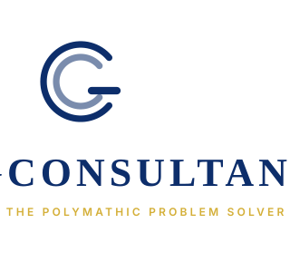
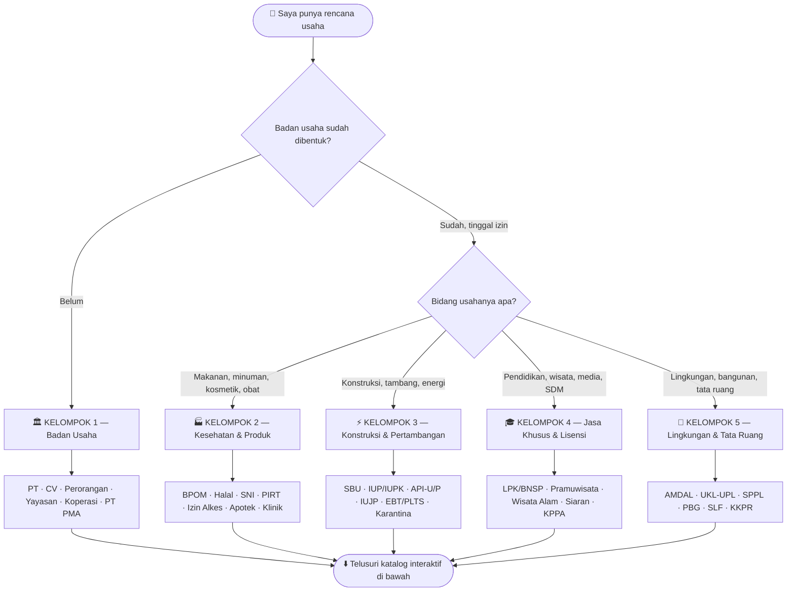
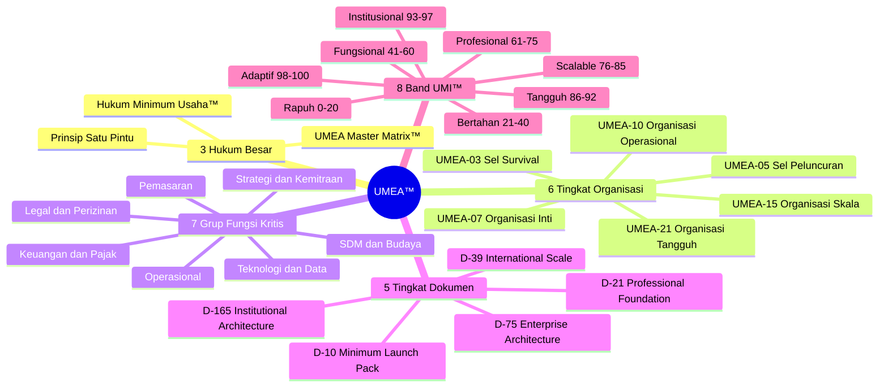
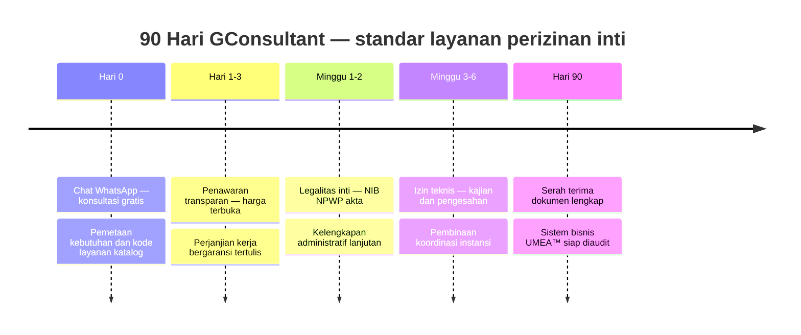
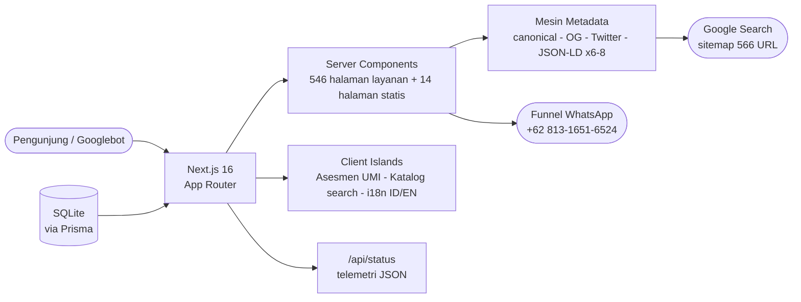

<div align="center">



# GCONSULTANT

### 🧩 The Polymathic Problem Solver

**Pusat Perizinan Terlengkap di Asia** · *The Most Complete Licensing Center in Asia*

*"Menyatukan ilmu. Menata kompleksitas. Mewujudkan solusi."*

<br>

[](https://nextjs.org)
[](https://www.typescriptlang.org)
[](https://gunara.web.id)
[](#transparansi)
[](https://bun.sh)

[](#katalog)
[](https://gunara.web.id/provinsi)
[](https://gunara.web.id/sitemap.xml)
[](#dashboard)

<a href="https://wa.me/6281316516524?text=Halo%20GConsultant%2C%20saya%20ingin%20konsultasi%20gratis."></a>

**Scan → Konsultasi Gratis** · [Bahasa Indonesia](#cerita) · [English](#en-story)

</div>

> [!IMPORTANT]
> **Verifikasi sebelum membayar.** Seluruh pembayaran HANYA ke rekening BCA a.n. **Gugun Gunara** (`0860742187`) dan seluruh resi dokumen dapat dicek ke instansi penerbit. Detail lengkap di [💰 Transparansi & Anti-Penipuan](#transparansi).

<a id="nav"></a>
## 🧭 Navigasi Kilat

| | | | |
|:---:|:---:|:---:|:---:|
| 🔍 [**Pencari Izin**](#pencari) | 🗂️ [**Katalog 546**](#katalog) | 🧠 [**Metodologi UMEA™**](#umea) | ⏱️ [**Perjalanan Klien**](#perjalanan) |
| 🧪 [**Checklist Diagnostik**](#checklist) | 📊 [**Dashboard Proyek**](#dashboard) | 🔌 [**Live Telemetry**](#telemetry) | 💰 [**Anti-Penipuan**](#transparansi) |
| 👤 [**Pendiri**](#pendiri) | 🚀 [**Developer Guide**](#developer) | 🔄 [**Riwayat Rilis**](#riwayat) | ❓ [**FAQ**](#faq) |

---

<a id="cerita"></a>
## 🇮🇩 Cerita 30 Detik

Website resmi **GConsultant** — berakar dari praktik konsultansi **Mic Kinsey sejak 2009**, dilembagakan sebagai badan usaha **AHU-038293.AH.01.30 Tahun 2024**, tersertifikasi **ISO 9001:2015**, melayani **38 provinsi Indonesia** dari dua kantor (Tasikmalaya + Jakarta/IDX Tower 1).

Situs ini tidak menjual "jasa ngurus izin" — situs ini menjual **metodologi**: [UMEA™](#umea), kerangka arsitektur sistem bisnis dengan 6 tingkat organisasi, 7 grup fungsi kritis, dan 5 tingkat dokumen. Katalog **546 layanan** perizinan (46 unggulan + 500 katalog [PusatPerizinan](https://pusatperizinan.com)) dipadukan dengan **mesin asesmen UMI™** berbasis 12 pertanyaan, dan seluruh funnel berujung pada **satu tombol WhatsApp** — tanpa form panjang, tanpa email yang tak pernah dibalas.

<a id="en-story"></a>
## 🇬🇧 The 30-Second Story

The official **GConsultant** website — rooted in **Mic Kinsey consulting practice since 2009**, incorporated as **AHU-038293.AH.01.30 (2024)**, certified **ISO 9001:2015**, serving **all 38 Indonesian provinces** from two offices (Tasikmalaya + Jakarta/IDX Tower 1). This site sells a **methodology**, not errands: [UMEA™](#umea) — a business-systems architecture with 6 organization levels, 7 critical function groups, and 5 document tiers — fused with a catalog of **546 licensing services** (46 flagship + 500 from [PusatPerizinan](https://pusatperizinan.com)) and a **12-question UMI™ maturity assessment**. Every path ends in **one WhatsApp button** — no long forms, no unanswered emails. This README itself is *living documentation*: telemetry badges read the production API, decision trees route readers, and every catalog link opens a real page.

---

<a id="angka"></a>
### 📐 GConsultant dalam Angka

| Angka | Arti | Verifikasi |
|:---:|---|---|
| **546** | Layanan aktif: 46 unggulan + 500 katalog | `/api/status` → `modules.servicesTotal` |
| **4 / 38** | Kategori besar / sub-kelompok layanan | [`/layanan`](https://gunara.web.id/layanan) |
| **38** | Provinsi terjangkau | [`/provinsi`](https://gunara.web.id/provinsi) |
| **6 / 21 / 5** | Tingkat organisasi / fungsi kritis / tier dokumen UMEA™ | [`/metodologi`](https://gunara.web.id/metodologi) |
| **12 → 0-100** | Soal asesmen → skor UMI™ + band kematangan | [`/asesmen`](https://gunara.web.id/asesmen) |
| **566** | URL terindeks sitemap (audit 101/101 perfect) | [`/sitemap.xml`](https://gunara.web.id/sitemap.xml) |
| **0** | Form yang wajib diisi sebelum bicara ke manusia | coba sendiri → [WA](https://wa.me/6281316516524?text=Halo%20GConsultant%2C%20saya%20ingin%20konsultasi%20gratis.) |

---

<a id="pencari"></a>
## 🔍 Pencari Izin dalam 30 Detik

**Diagram hidup pertama di README konsultan mana pun** — ikuti jalurnya, lalu klik kategori di [katalog](#katalog):



> [!TIP]
> **Trik pro:** di website, pencarian instan 546 layanan bisa dijangkau langsung lewat URL — `gunara.web.id/layanan?q=halal` atau `?q=NIB` atau `?q=kode layanan`. Kotak pencarian terisi sendiri dan halaman menggulir otomatis ke katalog.

---

<a id="katalog"></a>
## 🗂️ Katalog 546 Layanan — Interaktif

Klik setiap kelompok untuk membuka. Setiap tautan **hidup** — langsung menuju halaman layanan berisi harga, diskon resmi, proses, dokumen, dan FAQ.

<details open>
<summary><b>🏛️ KELOMPOK 1 — Badan Usaha & Legalitas Inti</b> <i>(fondasi segalanya)</i></summary>
<br>

| Layanan | Kandungan | Halaman |
|---|---|:---:|
| Pendirian PT | Akta, SK Kemenkumham, NIB, NPWP | [→ buka](https://gunara.web.id/layanan/pendirian-pt) |
| Pendirian PT PMA | Struktur investasi asing, BKPM | [→ buka](https://gunara.web.id/layanan/pendirian-pt-pma) |
| Pendirian CV | Sekaligus perizinan usaha | [→ buka](https://gunara.web.id/layanan/pendirian-cv) |
| Usaha Perseorangan (RUTBA) | Terbaru & tercepat untuk UMKM | [→ buka](https://gunara.web.id/layanan/usaha-perseorangan) |
| NIB OSS-RBA | Gerbang seluruh izin digital | [→ buka](https://gunara.web.id/layanan/nib-oss-rba) |
| Konversi CV → PT | Level up badan usaha | [→ buka](https://gunara.web.id/layanan/konversi-cv-menjadi-pt) |

**+ 40 layanan lain** — [telusuri seluruh kelompok ini](https://gunara.web.id/layanan) 🔎
</details>

<details>
<summary><b>🏭 KELOMPOK 2 — Kesehatan & Produk</b> <i>(BPOM · Halal · SNI)</i></summary>
<br>

| Layanan | Kandungan | Halaman |
|---|---|:---:|
| Izin Edar BPOM | Makanan, minuman, kosmetik, obat | [→ buka](https://gunara.web.id/layanan/izin-edar-bpom) |
| Sertifikasi Halal | Proses penuh s.d. sertifikat berlaku | [→ buka](https://gunara.web.id/layanan/sertifikasi-halal) |
| Sertifikasi SNI | Pasar ritel modern & tender | [→ buka](https://gunara.web.id/layanan/sertifikasi-sni) |
| PIRT | Rumah produksi skala kecil | [→ buka](https://gunara.web.id/layanan/pirt) |
| Registrasi Kosmetik/Suplemen | BPOM kategori kosmetik | [→ buka](https://gunara.web.id/layanan/registrasi-suplemen-kosmetik) |
| Izin Alkes & Apotek & Klinik | Distribusi alkes, apotek, klinik | [→ buka](https://gunara.web.id/layanan/izin-alkes) |

**+ keluarga layanan kesehatan lain** — [telusuri di sini](https://gunara.web.id/layanan?q=kesehatan) 🔎
</details>

<details>
<summary><b>⚡ KELOMPOK 3 — Konstruksi, Pertambangan & Energi</b></summary>
<br>

| Layanan | Kandungan | Halaman |
|---|---|:---:|
| SBU Konstruksi | Sertifikat badan usaha PU | [→ buka](https://gunara.web.id/layanan/sbu-konstruksi) |
| IUP / IUPK | Mineral & batubara, eksplorasi→operasi | [→ buka](https://gunara.web.id/layanan/iup) |
| API-U / API-P | Anggota penunjang / utama — ekspor impor | [→ buka](https://gunara.web.id/layanan/api-u) |
| IUJP Penunjang | Jasa jual beli penunjang migas | [→ buka](https://gunara.web.id/layanan/iujp-penunjang) |
| Izin EBT / PLTS | Energi baru terbarukan | [→ buka](https://gunara.web.id/layanan/izin-ebt-plts) |
| RPTKA / IMTA | Tenaga kerja asing | [→ buka](https://gunara.web.id/layanan/rptka-imta) |

**+ keluarga energi-tambang lain** — [telusuri di sini](https://gunara.web.id/layanan?q=tambang) 🔎
</details>

<details>
<summary><b>🎓 KELOMPOK 4 — Jasa Khusus, Pendidikan & Wisata</b></summary>
<br>

| Layanan | Kandungan | Halaman |
|---|---|:---:|
| Izin LPK + BNSP | Lembaga kursus & sertifikasi kompetensi | [→ buka](https://gunara.web.id/layanan/izin-lembaga-kursus-pelatihan-lpk) |
| Kartu Pramuwisata HPI | Legitimasi pemandu wisata | [→ buka](https://gunara.web.id/layanan/kartu-pramuwisata-hpi) |
| Izin Wisata Alam | Konservasi & pemanfaatan | [→ buka](https://gunara.web.id/layanan/izin-wisata-alam) |
| Biro Perjalanan | Legalitas usaha pariwisata | [→ buka](https://gunara.web.id/layanan/izin-biro-perjalanan-wisata) |
| Akreditasi Sekolah (BAN-S/M) | Yayasan pendidikan | [→ buka](https://gunara.web.id/layanan/akreditasi-sekolah-ban-s-m) |
| Izin Pondok Pesantren | Yayasan keagamaan | [→ buka](https://gunara.web.id/layanan/izin-operasional-pondok-pesantren) |

**+ keluarga jasa khusus lain** — [telusuri di sini](https://gunara.web.id/layanan?q=pendidikan) 🔎
</details>

<details>
<summary><b>🌿 KELOMPOK 5 — Lingkungan & Tata Ruang</b></summary>
<br>

| Layanan | Kandungan | Halaman |
|---|---|:---:|
| AMDAL | Kajian dampak lingkungan penuh | [→ buka](https://gunara.web.id/layanan/amdal) |
| UKL-UPL | Upaya pengelolaan & pemantauan | [→ buka](https://gunara.web.id/layanan/ukl-upl) |
| SPPL | Pernyataan pengelolaan sederhana | [→ buka](https://gunara.web.id/layanan/sppl) |
| PBG | Persetujuan bangunan gedung | [→ buka](https://gunara.web.id/layanan/pbg) |
| SLF | Sertifikat laik fungsi | [→ buka](https://gunara.web.id/layanan/slf) |
| KKPR | Konfirmasi kesesuaian tata ruang | [→ buka](https://gunara.web.id/layanan/kkpr) |

**+ keluarga lingkungan lain** — [telusuri di sini](https://gunara.web.id/layanan?q=lingkungan) 🔎
</details>

> [!NOTE]
> 500 layanan katalog memuat **harga resmi + diskon + estimasi hemat** yang tampil transparan di setiap halaman. Ingin membandingkan 546 sekaligus? Buka [`/layanan`](https://gunara.web.id/layanan) dan gunakan filter 4 kategori + 38 sub-kelompok.

---

<a id="umea"></a>
## 🧠 Metodologi UMEA™ — Satu Peta Otak

UMEA™ (*Universal Minimum Enterprise Architecture*) adalah produk inti GConsultant: kerangka yang menyatakan bahwa **setiap bisnis yang sehat hanya butuh struktur minimum yang tepat** — bukan kekacauan dokumen yang tak terpakai.



| Level | Nama Resmi | Untuk Siapa | Paket Dokumen | Fungsi |
|:---:|---|---|:---:|:---:|
| **UMEA-03** | Sel Survival | Titik nol — validasi ide | D-10 · *Minimum Launch Pack* | 3 |
| **UMEA-05** | Sel Peluncuran | Produk pertama masuk pasar | D-21 · *Professional Foundation* | 5 |
| **UMEA-07** | Organisasi Inti | Tim inti — *Seven Critical Functions* | D-21 · *Professional Foundation* | 7 |
| **UMEA-10** | Organisasi Operasional | 7 pemilik fungsi + 3 eksekutor | D-39 · *International Scale* | 10 |
| **UMEA-15** | Organisasi Skala | Multi-produk, multi-cabang | D-39 / D-75 | 15 |
| **UMEA-21** | Organisasi Tangguh | Korporasi resilient — *7 grup × 3 lapis* | D-165 · *Institutional Architecture* | 21 |

> [!TIP]
> Tidak tahu usaha Anda level berapa? Itulah fungsi **[Asesmen UMI™](https://gunara.web.id/asesmen)** — 12 pertanyaan, ±3 menit, keluar skor 0–100 + band kematangan + rekomendasi paket dokumen. Gratis, tanpa data pribadi.

---

<a id="perjalanan"></a>
## ⏱️ Perjalanan Klien — Dari Chat hingga Beroperasi



**Mengapa bisa dijanjikan?** Karena ISO 9001:2015 memaksa setiap proses punya SOP terukur, dan garansi tertulis diserahkan di Hari 1–3 — sebelum pembayaran tahap kedua. Detail per layanan tampil jujur di tiap halaman katalog.

---

<a id="checklist"></a>
## 🧪 Checklist Kesiapan Usaha — *Self-Diagnostic*

Centang langsung di sini (GitHub menyimpan centang Anda di fork/repo sendiri). **≥8 centang = siap diaudit; ≤4 centang = mulai dari UMEA-03.**

- [ ] Badan usaha sah (akta + SK Kemenkumham / RUTBA)
- [ ] NIB aktif di OSS-RBA
- [ ] NPWP badan & PKP (jika perlu faktur pajak)
- [ ] Izin spesifik sektor (BPOM / SNI / SBU / IUP / dst.)
- [ ] Rekening bank a.n. badan usaha — bukan a.n. pribadi
- [ ] Kontrak kerja tertulis seluruh karyawan inti
- [ ] Sistem pembukuan terpisah dari dompet pribadi
- [ ] Dokumen lingkungan (KKPR / SPPL / UKL-UPL / AMDAL sesuai skala)
- [ ] Aset fisik ber-PBG & ber-SLF
- [ ] SOP proses inti tertulis ( minimal 3 proses )
- [ ] Data pelanggan & kepatuhan UU PDP No. 27/2022
- [ ] Evaluasi kinerja berkala (bulanan / triwulanan)

> [!WARNING]
> Lebih dari separuh kosong? Jangan beli izin satu-satu tanpa peta — itulah biaya tersembunyi termahal. Mulai dari [asesmen gratis](https://gunara.web.id/asesmen) atau [chat langsung](https://wa.me/6281316516524?text=Halo%20GConsultant%2C%20hasil%20checklist%20saya%20masih%20banyak%20yang%20kosong%2C%20mohon%20pemetaannya.).

---

<a id="dashboard"></a>
## 📊 Dashboard Kesehatan Proyek

Metrik yang diperiksa otomatis setiap rilis — semuanya bisa Anda verifikasi sendiri:

| Domain | Metrik | Nilai | Cara Verifikasi |
|---|---|:---:|---|
| **Katalog** | Layanan aktif | 546 | `curl gunara.web.id/api/status` |
| **SEO** | URL sitemap | 566 | `curl gunara.web.id/sitemap.xml \| grep -c loc` |
| **SEO** | Audit 11 kriteria Google | **101/101** | `python3 scripts/seo-audit.py` |
| **SEO** | Canonical benar / noindex bocor | 100% / 0 | hasil audit — kolom canonical & noindex |
| **Schema** | JSON-LD per halaman | 6–8 blok | view-source → `application/ld+json` |
| **Kualitas** | ESLint error | 0 | `bun run lint` |
| **Aksesibilitas** | Halaman tanpa h1 ganda | 100% | audit v2 — kolom h1 |
| **Infra** | Security headers | 6 lapis | `curl -I gunara.web.id` |
| **i18n** | Simetri ID ⇄ EN | 100% | toggle di navbar situs |

---

<a id="telemetry"></a>
## 🔌 Live Telemetry — *Badge yang Hidup*

> **Ini yang belum dimiliki README konsultan mana pun di dunia:** badge di bawah ini **membaca langsung API produksi** (`/api/status`) setiap kali halaman README dimuat. Bukan teks statis yang ditulis tahu-tahu benar — telemetri nyata.

| Badge | Sumber Data |
|---|---|
|  | `$.version` |
|  | `$.status` |
|  | `$.release` |

> [!NOTE]
> Badge akan **menyala otomatis** begitu v3.3.0 dideploy ke produksi (saat ini produksi masih menjalankan build lama tanpa endpoint `/api/status`). Tidak ada yang perlu diedit di README ini — itulah makna *living documentation*.

---

<a id="transparansi"></a>
## 💰 Transparansi & Anti-Penipuan

Legitimasi bukan klaim — semua bisa dicek publik:

| Sumber Kebenaran | Nilai | Cara Cek Sendiri |
|---|---|---|
| **Pencatatan Kemenkumham** | `AHU-038293.AH.01.30.Tahun 2024` | [pencatatan.kemenkumham.go.id](https://pencatatan.kemenkumham.go.id) → cari "Gunara Consultant" |
| **Modal dasar** | Rp5.000.000.000 (lima miliar Rupiah) | dokumen AHU di atas |
| **Sertifikasi mutu** | ISO 9001:2015 | sertifikat ditampilkan di [`/tentang-kami`](https://gunara.web.id/tentang-kami) |
| **Rekening resmi pembayaran** | BCA `0860742187` a.n. **Gugun Gunara** | cocokkan sebelum transfer; tolak rekening lain |
| **Kantor fisik** | Tasikmalaya + Jakarta (IDX Tower 1 L3 #304) | [`/kontak`](https://gunara.web.id/kontak) — boleh kunjungi |
| **Kepatuhan data pribadi** | UU No. 27/2022 (PDP) | [`/kebijakan-privasi`](https://gunara.web.id/kebijakan-privasi) |

> [!CAUTION]
> Jika ada pihak mengaku staf GConsultant namun meminta transfer ke **rekening selain BCA 0860742187 a.n. Gugun Gunara** — itu penipuan. Laporkan langsung ke [WhatsApp resmi](https://wa.me/6281316516524?text=Halo%2C%20saya%20menemukan%20indikasi%20penipuan%20atas%20nama%20GConsultant.).

---

<a id="pendiri"></a>
## 👤 Pendiri & Warisan

<div align="center">


**Gugun Gunara** · Founder & CEO

*Warisan praktik konsultansi Mic Kinsey sejak 2009 — 15+ tahun memetakan kompleksitas usaha Indonesia sebelum mengarsitekinya menjadi UMEA™.*

</div>

| | |
|---|---|
| Filosofi | *The Polymathic Problem Solver* — satu otak yang menyatukan hukum, sistem, dan teknologi |
| Jejak | [`/pendiri`](https://gunara.web.id/pendiri) · [`/tentang-kami`](https://gunara.web.id/tentang-kami) |
| Jaringan grup | [PusatPerizinan.com](https://pusatperizinan.com) — mesin katalog 500 layanan |

---

<a id="developer"></a>
## 🚀 Panduan Developer — Quick Start

### Prasyarat & Instalasi

```bash
# 1. Prasyarat: Node.js ≥ 20 + Bun ≥ 1.1
git clone https://github.com/gunaracorp/gunaraconsultant.git
cd gunaraconsultant

# 2. Instal dependensi (bun — cepat & deterministik)
bun install

# 3. Database SQLite (Prisma)
export DATABASE_URL="file:/home/z/my-project/db/custom.db"

# 4. Jalankan dev server → http://localhost:3000
bun run dev
```

### 📜 Perintah & Env Vars

| Perintah | Fungsi |
|---|---|
| `bun run dev` | Dev server + hot reload (port 3000) |
| `bun run lint` | ESLint — wajib 0 error sebelum commit |
| `bun run build` | Build produksi (prerender 46 layanan unggulan; 500 katalog on-demand) |
| `bunx prisma db push` | Sinkron skema database |

| Env Var | Wajib? | Fungsi |
|---|:---:|---|
| `DATABASE_URL` | ✅ | Lokasi file SQLite |
| `FRAME_POLICY` | 🟡 | `sameorigin` di produksi (anti-klikjacking); default preview = longgar |
| `NEXT_PUBLIC_GOOGLE_SITE_VERIFICATION` | 🟡 | Meta verifikasi Google Search Console — muncul otomatis saat di-set |
| `NEXT_PUBLIC_GA_ID` / `NEXT_PUBLIC_CLARITY_ID` | 🟡 | Analytics GA4 / Microsoft Clarity |

### 🏗️ Arsitektur Satu Gambar



### 🗺️ Peta Rute

| Rute | Isi | Rute | Isi |
|---|---|---|---|
| `/` | Beranda polymathic | `/blog/[slug]` | 6 artikel bilingual |
| `/layanan` | Hub 546 + pencarian `?q=` | `/metodologi` | UMEA™ lengkap |
| `/layanan/[slug]` | 46 unggulan + 500 katalog | `/asesmen` | Mesin UMI™ 12 soal |
| `/provinsi` | 38 provinsi | `/faq` · `/kontak` | Jawaban + funnel WA |
| `/tentang-kami` · `/pendiri` | Profil & legitimasi | `/api/status` | Telemetri JSON |
| `/keunggulan` · `/proses` | Diferensiasi & SOP | `/kebijakan-privasi` · `/syarat-ketentuan` | Legal UU PDP |

### ✅ Verifikasi Kesehatan (jalankan setelah deploy)

```bash
# Telemetri inti
curl -s http://localhost:3000/api/status | jq

# Audit SEO 11 kriteria — wajib PERFECT 101/101
python3 scripts/seo-audit.py

# Cek cepat robots + sitemap + landing pencarian
curl -s localhost:3000/robots.txt
curl -s localhost:3000/sitemap.xml | grep -c "<loc>"
curl -s -o /dev/null -w "%{http_code}\n" "localhost:3000/layanan?q=halal"
```

---

<a id="riwayat"></a>
## 🔄 Riwayat Rilis

| Versi | Nama Rilis | Sorotan |
|:---:|---|---|
| **3.3.0** | *Google Search Optimization* | Audit 101/101 · robots dinamis · sitelinks search box hidup · clamp title/desc SERP |
| **3.2.0** | *Full Catalog Integration* | +500 layanan PusatPerizinan → 546 aktif · harga transparan berdiskon · sitemap 566 |
| **3.1.1** | *Preview Iframe Hardening* | CSP `frame-ancestors` adaptif — fix "refused to connect" |
| **3.1.0** | *Lead UX Hardening* | Form kontak anti silent-fail · validasi aksesibel · funnel WA teruji E2E |
| **3.0.0** | *Polymathic Rebrand* | Identitas Geometric G · UMEA™ · asesmen UMI™ · i18n penuh |

📜 Detail lengkap tiap rilis: [`CHANGELOG.md`](CHANGELOG.md)

---

<a id="faq"></a>
## ❓ FAQ Cepat

<details>
<summary><b>Apakah konsultasi pertama benar-benar gratis?</b></summary>
Ya — tanpa syarat, tanpa form. Langsung chat WhatsApp, langsung dijawab manusia yang paham regulasi.
</details>

<details>
<summary><b>Berapa biaya per layanan?</b></summary>
Harga resmi + diskon + estimasi hemat tampil terbuka di setiap halaman katalog (500 layanan). Layanan unggulan (46) menawarkan harga penawaran via WhatsApp sesuai kondisi usaha Anda.
</details>

<details>
<summary><b>Jika permohonan ditolak instansi?</b></summary>
Perjanjian kerja memuat klausul garansi: pendampingan revisi tanpa biaya tambahan hingga selesai. Inilah makna sertifikasi ISO 9001:2015 pada proses, bukan sekadar sertifikat di dinding.
</details>

<details>
<summary><b>Seluruh Indonesia?</b></summary>
38 provinsi. Konsultasi daring untuk seluruh wilayah; kunjungan lapangan dijadwalkan per kebutuhan.
</details>

<details>
<summary><b>Bisa bahasa Inggris?</b></summary>
Seluruh situs bilingual ID ⇄ EN (toggle navbar), dan tim melayani investor asing (PT PMA, KITAS) dalam keduanya.
</details>

---

<a id="kontak"></a>
## 📞 Hubungi — Tanpa Form, Langsung Manusia

<div align="center">

| Saya butuh… | Klik — pesan tersusun otomatis |
|---|:---:|
| Konsultasi umum / belum tahu mulai dari mana | [💬 Chat sekarang](https://wa.me/6281316516524?text=Halo%20GConsultant%2C%20saya%20ingin%20konsultasi%20gratis.) |
| Pendirian PT / CV / badan usaha | [💬 Chat sekarang](https://wa.me/6281316516524?text=Halo%2C%20saya%20ingin%20pendirian%20badan%20usaha.%20Mohon%20info%20syarat%20dan%20biayanya.) |
| Izin BPOM / Halal / SNI / PIRT | [💬 Chat sekarang](https://wa.me/6281316516524?text=Halo%2C%20saya%20butuh%20izin%20produk%20BPOM%2FHalal%2FSNI.%20Mohon%20bantuannya.) |
| Diskusi hasil Asesmen UMI™ | [💬 Chat sekarang](https://wa.me/6281316516524?text=Halo%2C%20saya%20sudah%20mengerjakan%20Asesmen%20UMI%20dan%20ingin%20diskusi%20hasilnya.) |
| Layanan katalog (punya kode layanan) | [💬 Chat sekarang](https://wa.me/6281316516524?text=Halo%2C%20saya%20menemukan%20layanan%20kode%20ISI-KODE%20di%20katalog%20Anda.%20Mohon%20detailnya.) |

**+62 813-1651-6524** · [halo@gunara.web.id](mailto:halo@gunara.web.id) · 🌐 [gunara.web.id](https://gunara.web.id)

📍 Tasikmalaya: Andalusia Garden Cluster Granada No.11 · 🏙️ Jakarta: IDX Tower 1 L3 Unit 304
🕐 Senin–Sabtu, 08.00–17.00 WIB

</div>

---

<a id="lisensi"></a>
## ⚖️ Lisensi & Hak Kekayaan Intelektual

© 2024–2026 GConsultant (Gunara Consultant). Seluruh identitas — logo *Geometric G*, nama, istilah **UMEA™**, *Hukum Minimum Usaha™*, *UMEA Master Matrix™*, *UMEA Maturity Index™*, dan struktur D-10/D-21/D-39/D-75/D-165 — dilindungi undang-undang hak cipta, merek, dan rahasia dagang Republik Indonesia. Repositori ini bersifat proprietary; fork untuk audit diperbolehkan, penggunaan komersial tanpa izin tertulis dilarang. Lihat [`/syarat-ketentuan`](https://gunara.web.id/syarat-ketentuan).

---

<div align="center">

<sub><b>GCONSULTANT</b> — Kompleksitas memiliki struktur. Solusi memiliki jalur.</sub>

<sub>
<a href="https://gunara.web.id">🌐 Situs</a> ·
<a href="https://gunara.web.id/layanan">🗂️ 546 Layanan</a> ·
<a href="https://gunara.web.id/asesmen">🧪 Asesmen Gratis</a> ·
<a href="https://wa.me/6281316516524">💬 WhatsApp</a> ·
<a href="https://pusatperizinan.com">🤝 Grup</a>
</sub>


</div>
